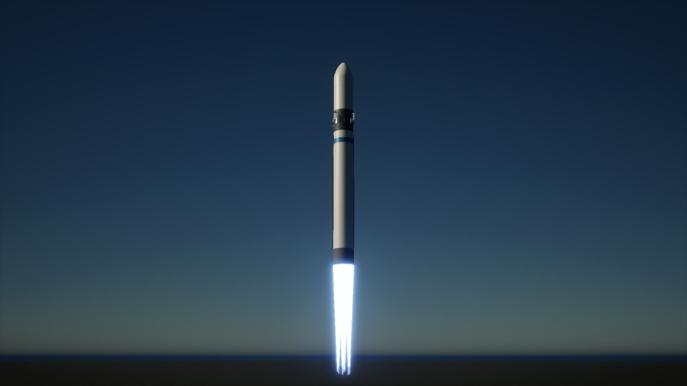
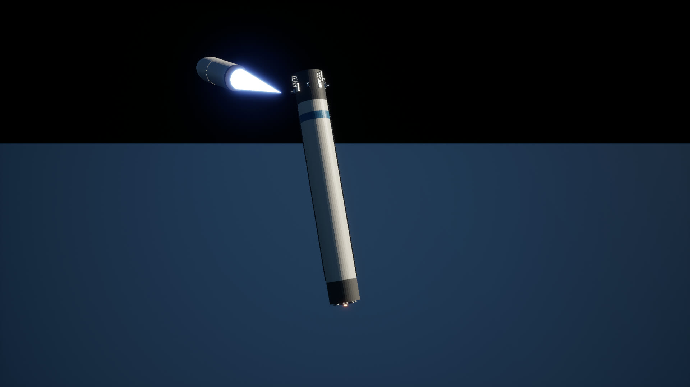
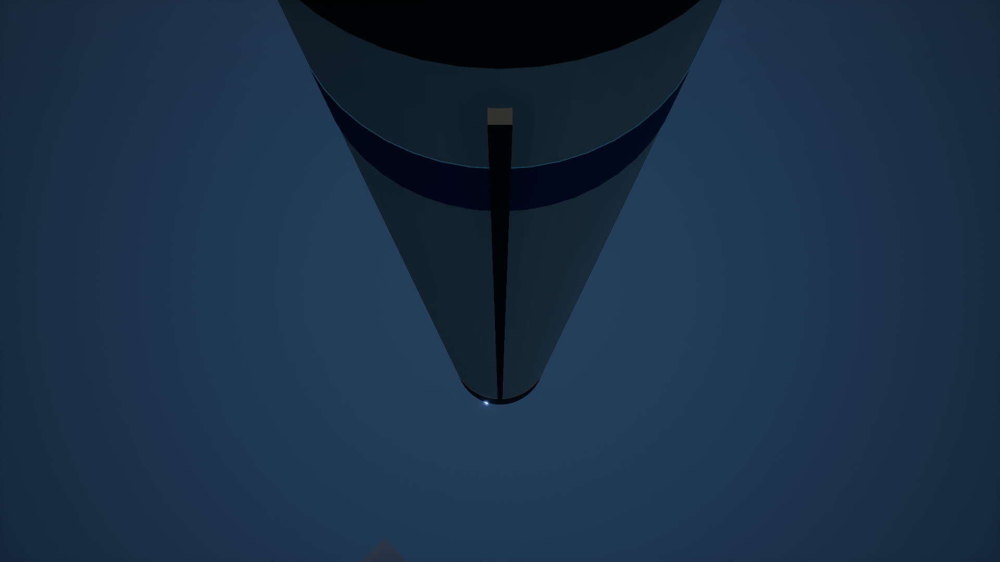
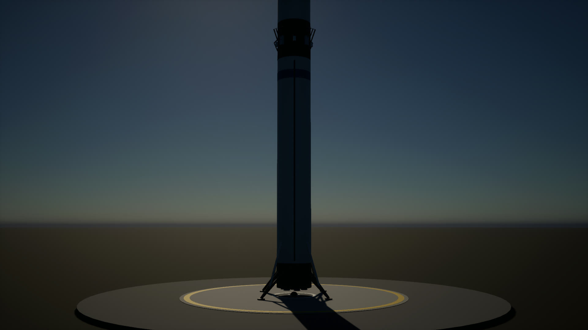

# DM100 3D — 6DOF MuJoCo Rocket Recovery & Unreal Engine 5.4 Cinematics

[](https://github.com/Dongmyung378/DM100-3D-Rocket-Recovery/actions/workflows/ci.yml)

6DOF 3D extension of [DM100-2D-Rocket-Recovery](https://github.com/Dongmyung378/DM100-2D-Rocket-Recovery): a 100 t Methalox two-stage launch vehicle placing a 1,800 kg payload into a **700 ± 15 km circular orbit** while returning the 1st-stage booster via **8-phase 6DOF RTLS**, **unpowered 4-grid-fin crossrange aero glide (0% main throttle)**, **3→1 minimum-throttle Hoverslam (Clarabel 3D GFOLD SOCP)**, **4-leg telescoping touchdown with 5 s engine-off upright stability**, and **Unreal Engine 5.4 1080p offline cinematics**.

| Liftoff (7 Methalox Engines) | Stage Separation & Exo-Atmospheric Flip |
| :---: | :---: |
|  |  |
| **Onboard Grid-Fin Entry Burn** | **4-Leg Touchdown on 2 m Bullseye** |
|  |  |

---

## Verified 96 / 96 (100.0%) 6DOF Validation Results

All 96 closed-loop `float64` RK4 MuJoCo missions (**32 adversarial `edge-3d` boundary/nightmare scenarios** + **64 unseen Monte Carlo `holdout-3d` scenarios**) were executed on **Kaggle CPU shards (4 parallel kernels × 4 vCPU = 16 vCPU, 0 GPU quota)** with strict plant/controller causality isolation (`TelemetryPacket3D → ActuatorCommand3D`).

| Metric | Safety Limit | `edge-3d` (32/32) | `holdout-3d` (64/64) | **`full-3d` (96/96)** |
| --- | --- | :---: | :---: | :---: |
| **Mission Pass Rate (19 Criteria)** | 100% | **32 / 32 (100.0%)** | **64 / 64 (100.0%)** | **96 / 96 (100.0%)** |
| **Touchdown Position Error (Median / Max)** | `≤ 2.00 m` | `0.0014 m` / `0.135 m` | `0.0090 m` / `0.122 m` | **`0.0027 m` / `0.135 m`** |
| **Horizontal / Vertical Contact Speed** | `≤ 0.50` / `≤ 1.50 m/s` | `0.049` / `1.111 m/s` | `0.140` / `0.966 m/s` | **`0.140` / `1.111 m/s`** |
| **Touchdown Tilt / Contact Rate** | `≤ 3.00°` / `≤ 0.50 deg/s` | `1.97°` / `0.200 deg/s` | `1.97°` / `0.349 deg/s` | **`1.97°` / `0.349 deg/s`** |
| **Peak Angular Rate / Accel** | `≤ 15.0` / `≤ 5.0 deg/s²` | `11.06` / `4.58 deg/s²` | `11.08` / `4.43 deg/s²` | **`11.08` / `4.58 deg/s²`** |
| **Peak Roll Excursion** | `≤ 5.00°` | `0.41°` | `0.34°` | **`0.41°`** |
| **Peak Dynamic Pressure / Heat Flux** | `≤ 42 kPa` / `≤ 80 kW/m²` | `31.76 kPa` / `17.75 kW/m²` | `31.22 kPa` / `19.62 kW/m²` | **`31.76 kPa` / `19.62 kW/m²`** |
| **Peak Per-Fin Hinge Moment** | `≤ 7,500 N·m` | `1,357.4 N·m` | `1,545.9 N·m` | **`1,545.9 N·m`** |
| **4-Leg Stroke / Force / Contact Load** | `≤ 0.90 m` / `≤ 250 kN` / `≤ 4.0 g` | `0.404 m` / `41.9 kN` / `1.70 g` | `0.412 m` / `42.5 kN` / `1.70 g` | **`0.412 m` / `42.5 kN` / `1.70 g`** |
| **Stage 2 700 km Orbit / 5 s Upright Settle** | 100% | **32 / 32** | **64 / 64** | **96 / 96 (100%)** |

Full merged dataset: [docs/results/validation_3d_full96.json](docs/results/validation_3d_full96.json) · Detailed Korean report: [docs/validation.ko.md](docs/validation.ko.md)

---

## Architecture Overview

- **Stage 2 — 6DOF MuJoCo Physics & Strictly Causal GNC** ([docs/spec.ko.md](docs/spec.ko.md)):
  - **MuJoCo 6DOF Multibody Plant** (`src/dm100_3d/mjcf/builder.py`, `plant_mujoco.py`, `sim_3d.py`): `float64` RK4 integrator, hull-base origin (`station = 0.0 m`), 50 Hz `mj_setConst` dynamic mass/COM/3-axis inertia updates, 4 independent hinged grid fins, and 4 telescoping landing struts (`k = 80 kN/m`, `c = 22.5 kN·s/m` per leg, `dt = 0.002 s` contact zone).
  - **Pure 3D External Physics** (`src/dm100_3d/physics/`): 3D aerodynamics, 4-fin aero & hinge limits, 7→3→1 Methalox cluster, 2-axis conical TVC (`±6°`), 3-axis RCS, $2\pi$-periodic symplectic 2-DOF spherical-pendulum slosh, closed helium pressurization, 3D Coriolis/centrifugal acceleration, and 3D spherical-Earth Stage 2 orbital insertion + 25 s departure trajectory.
  - **Strictly Causal 6DOF GNC** (`src/dm100_3d/gnc/`): 15-State MEKF with 3-axis aerodynamic disturbance torque observer, 3×9 priority control allocator (operating-point finite-difference 4-fin linearization → 2-axis conical TVC → 3-axis RCS), and Clarabel 3D GFOLD SOCP with analytic 3D zero-tilt fallback.
- **Cloud-Native Validation Offload** (`scripts/kaggle/`):
  - Deterministic `--shard k/N` + JSONL `--resume` checkpointing for free Kaggle CPU multi-kernel execution.
- **Stage 3 — Unreal Engine 5.4 Offline Cinematics** ([docs/ue5_pipeline.ko.md](docs/ue5_pipeline.ko.md)):
  - Exact-dimension procedural PBR `.glb` meshes (`ue5/scripts/generate_rocket_glb.py`, 5 assets verified via `tests/test_ue5_assets.py`).
  - Reflection-matrix ENU RH(m, `wxyz`) → UE5 LH(cm, `FQuat`/`FRotator`) transform math (`ue5/scripts/ue5_transform_math.py`, verified across 3D orientations).
  - Automated headless `UnrealEditor-Cmd.exe` replay importer (`ue5/scripts/import_dm100_replay.py`) building an LWC (`0–110 km`) Level + 50 fps `LevelSequence` with 4 CineCameras, `7→3→1` Methalox plumes, RCS puffs, reentry heating, and 4-fin/4-leg articulation.
  - RTX 3060 6 GB VRAM friendly offline 1080p Movie Render Queue executor (`ue5/DM100Cinematics/Content/Python/dm100_mrq_executor.py`) + `ffmpeg` H.264 MP4 muxer (`ue5/scripts/render_mrq.py`).

---

## Quick Start

```bash
# 1. Install in editable mode with dev & asset dependencies
pip install -e ".[dev]"

# 2. Run fast verification suite (physics, 2D-3D equivalence, MEKF, 3x9 allocator, Clarabel SOCP, replay, GLB, UE5 math)
pytest -m "not slow"
ruff check src tests scripts ue5/scripts
ruff format --check src tests scripts ue5/scripts

# 3. Generate exact-dimension DM100 procedural GLB meshes for UE 5.4
python ue5/scripts/generate_rocket_glb.py --out ue5/assets/meshes

# 4. Offload 96-case 6DOF validation to Kaggle CPU shards
python scripts/kaggle/push_kaggle_shards.py --suite edge-3d --shards 4
python scripts/kaggle/push_kaggle_shards.py --suite holdout-3d --shards 4
```

## Documentation

- [시스템 명세서 (docs/spec.ko.md)](docs/spec.ko.md)
- [96건 대규모 6DOF 검증 리포트 (docs/validation.ko.md)](docs/validation.ko.md)
- [Unreal Engine 5.4 시네마틱 파이프라인 (docs/ue5_pipeline.ko.md)](docs/ue5_pipeline.ko.md)
